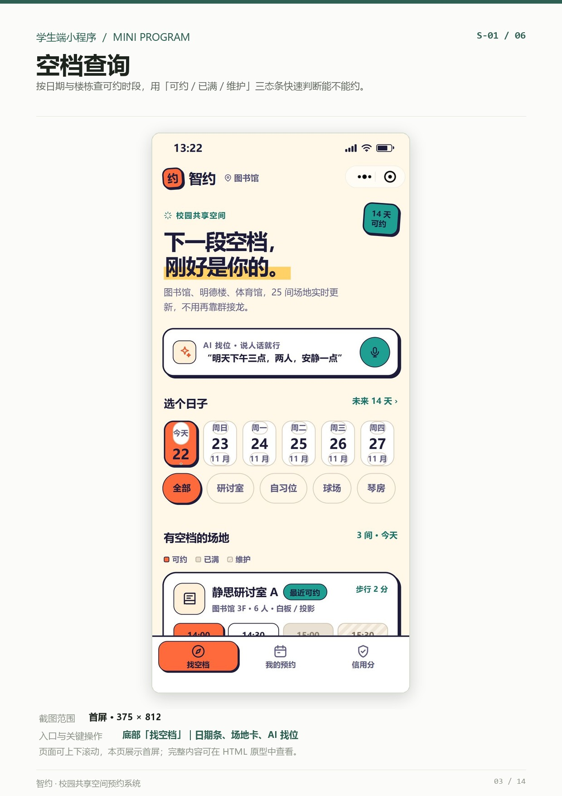
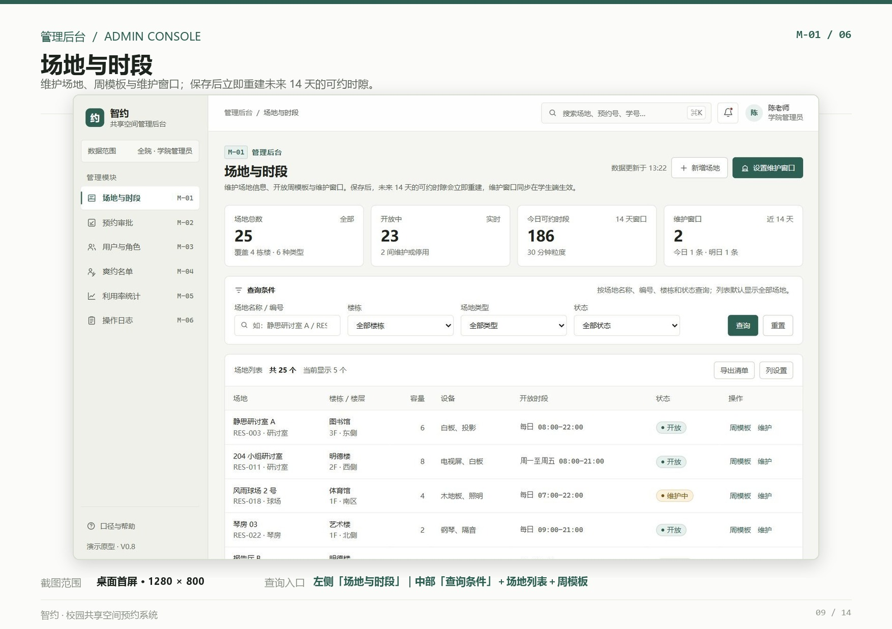

# 「智约」校园共享空间预约平台

> 计算机学院 · 专业基础实践 · 课程设计
> 24 软工 B 班 · 课程设计小组 · 需求说明书 V0.8

把校园里最难约的空间——研讨室、自习位、球场、琴房——变成**可预约、可释放、可追责**的资源。
学生用微信小程序查空档、下单、扫码签到；场地管理员在后台维护时段、审批、处理爽约；学院管理员管账号、规则参数与统计。

- 代码仓库：<https://github.com/2333weda/git>
- 需求说明书：[docs/requirements/智约-需求说明书-V0.8.pdf](docs/requirements/智约-需求说明书-V0.8.pdf)（Word 版同目录）
- 低保真原型：[docs/prototypes/智约-产品原型截图集.pdf](docs/prototypes/智约-产品原型截图集.pdf) · [可交互 HTML 稿](docs/prototypes/html/)
- 线上地址：（部署后回填）

---

## 1. 项目概述

**背景。** 共享空间长期靠微信群接龙、纸质登记和口头协调分配，资源一紧张就失效：空档不可见，学生走到门口才发现房间被占；登记后不到场，时段被白占却无人收回；撞场时拿不出"谁先约、谁违约"的凭据；学院想知道哪几间最紧张，只能人工翻表。

**建设目标。** 跑通"查空档 — 提交预约 — 到店签到 — 结束释放 — 信用结算"五步闭环。前三步是及格线（查询须排除维护窗口与已取消单；同一时段并发提交只能成功一个；超时未签自由定时任务自动释放）；后两步是加分项，让"预约"升级为"治理"。

**交付形态。** 公有云真实域名 + HTTPS，评审当天换一台陌生手机扫码即可使用。

**明确不做**（避免实现阶段扩张）：不做支付与费用结算；不做实名认证与人脸识别；不接学校统一身份认证；不做门禁闸机等硬件联动；不做跨校区与第三方场馆对接；学生端只做微信小程序，不提供 App 或 Web 端。

## 2. 当前进度

| 阶段 | 产出物 | 状态 |
| --- | --- | --- |
| 需求分析 | 需求说明书 V0.8（第 1—7 章） | ✅ 已完成 |
| 原型设计 | 小程序 6 页 + 后台 6 模块低保真稿 | ✅ 已完成 |
| 工程设计 | 仓库、目录结构、分支与提交规范 | ✅ 本次完成 |
| 概要 / 详细设计 | 模块设计、接口契约、表结构 | ⬜ 待开始 |
| 编码实现 | 小程序、后台、API、数据库 | ⬜ 待开始 |
| 部署交付 | 云端环境、HTTPS、探活与备份 | ⬜ 待开始 |

## 3. 角色与权限

采用"**角色 + 数据范围**"双层模型：角色决定能做什么，数据范围决定能看哪一片。两者由服务端解析登录态后强制注入查询条件——前端隐藏按钮只改善体验，不构成权限。

| 角色 | 入口 | 主要职责 | 数据范围 | 关键限制 |
| --- | --- | --- | --- | --- |
| 学生 `STUDENT` | 微信小程序 | 查空档、下单、签到、取消、申诉、查信用分 | 本人 `SELF` | 看不到他人预约与手机号，不能调 `/admin` 接口 |
| 场地管理员 `MANAGER` | Vue 3 后台 | 维护名下场地与开放时段、审批、核对签到、处理爽约、导出脱敏报表 | 本场地 `RESOURCE` | 越界一律 403；不能授角色、改日志、改规则参数 |
| 学院管理员 `COLLEGE_ADMIN` | Vue 3 后台 | 账号与角色、六项规则参数、统计口径、日志审计（只读） | 全院 `COLLEGE` | 不参与日常审批（避免既审批又审计）；不可读 openid 与会话；不可删日志 |

越权统一错误码：横向越权 `403 DATA_FORBIDDEN`，纵向越权 `403 ROLE_FORBIDDEN`，越界数据 `403 SCOPE_DENIED`，未登录 `401 UNAUTHENTICATED`。列表接口不得接受前端传入的 `user_id` / `resource_id` 作为过滤依据。脱敏在序列化层统一实现（手机号 `138****5678`，姓名"张\*"，学号非本人只留前 4 后 2 位）。

## 4. 业务规则卡（学期内不得更换）

| 参数 | 取值 | 落到实现上的影响 |
| --- | --- | --- |
| 最小预约粒度 | 30 分钟 | 时隙按 30 分钟切片，选择器只给 `:00` / `:30` |
| 单次最长时长 | 4 小时 | `end_at − start_at ≤ 4h`，等于 4 小时允许 |
| 相邻时段 | 需间隔 20 分钟 | 紧邻（间隔 0）不合法；恰好间隔 20 分钟允许 |
| 提前预约窗口 | 14 天 | 只可约 `[now, now + 14 天)`，按 Asia/Shanghai 自然日 |
| 未签到自动释放 | 15 分钟 | 每分钟扫描 `PENDING` 且超 `start_at + 15min` 的单，置 `NO_SHOW` 并释放 |
| 爽约停权 | 3 次，停 7 天 | 90 天内满 3 次，写入 `suspend_until = 第 3 次爽约 + 7 天` |

时段一律用左闭右开区间 `[start_at, end_at)`。两条硬判据：

```text
重叠：new_start < existing_end AND new_end > existing_start
间隔：后段开始 − 前段结束 < 20 分钟   （前后两侧各算一次，取更小的那个）
```

## 5. 业务约束与错误码

约束条目 C-01 ~ C-10 详见需求说明书第 3 章，此处为速查表：

| 编号 | 约束 | 判定要点 | 错误码 / HTTP |
| --- | --- | --- | --- |
| C-01 | 提前预约窗口越界 | 早于当前时间，或晚于"当前 + 14 天" | `WINDOW_EXCEEDED` / 400 |
| C-02 | 单次最长时长超限 | 时长 > 4 小时（等于允许） | `DURATION_EXCEEDED` / 400 |
| C-03 | 预约粒度不匹配 | 开始时间或时长非 30 分钟整数倍 | `SLOT_ALIGN_INVALID` / 400 |
| C-04 | 时间顺序或跨天 | 结束 ≤ 开始，或跨自然日 | `TIME_INVALID` / 400 |
| C-05 | 时段重叠 | 与 `PENDING` / `CHECKED_IN` 单重叠（首尾相接不算） | `SLOT_CONFLICT` / 409 |
| C-06 | 相邻间隔不足 | 与前后预约空隙 < 20 分钟（等于允许） | `GAP_REQUIRED` / 409 |
| C-07 | 并发抢同一时隙 | 50 并发仅 1 条成功，库中不得出现两条 `PENDING` | `SLOT_TAKEN` / 409 |
| C-08 | 超时未签到释放 | 超 `start_at + 15min` 仍 `PENDING` | 状态置 `NO_SHOW` 并释放 |
| C-09 | 爽约停权 | 90 天内 3 次，或当前处于停权期 | `SUSPENDED` / 403 |
| C-10 | 维护窗口内预约 | 与维护记录重叠 | `MAINTENANCE_WINDOW` / 409 |

**校验顺序固定**，遇到第一个不满足即返回，不同时抛多个错误：

```text
登录态与角色 → C-09 停权 → C-01 窗口 → C-03 粒度 → C-02 时长
→ C-04 时间合法 → C-10 维护窗口 → C-05 重叠 → C-06 间隔 → C-07 并发写入
```

前端按错误码分支处理，不解析提示文案。

## 6. 功能范围

**学生端（微信小程序 6 页）**

| 编号 | 页面 | 核心动作 |
| --- | --- | --- |
| S-01 | 空档查询 | 按日期/楼栋/时段查三态（可约 / 已满 / 维护），支持"明天下午三点两人安静的地方"式自然语言入口 |
| S-02 | 预约下单 | 按固定顺序校验 C-09→C-01→C-03→C-02→C-04→C-10→C-05→C-06→C-07，事务内占住时隙 |
| S-03 | 扫码签到 | 一次性 token 或管理员口令，窗口为开始前 15 分钟至开始后 15 分钟 |
| S-04 | 我的预约 | 只查本人记录，按状态机开放签到 / 取消 / 提前结束 / 申诉 |
| S-05 | 取消与申诉 | 取消即释放时段；申诉仅对 `NO_SHOW` 或停权记录开放，一条记录限一次 |
| S-06 | 信用分 | 信用分（初始 100，每次爽约 −10）、90 天爽约次数、停权截止日与扣分明细 |

**管理端（Vue 3 后台 6 模块）**

| 编号 | 模块 | 核心动作 |
| --- | --- | --- |
| M-01 | 场地与时段 | 场地信息、周模板开放时段、维护窗口；保存后重建未来 14 天时隙 |
| M-02 | 预约审批 | 超 4 小时、跨场地借用、临时关闭补偿；不得自审 |
| M-03 | 用户与角色 | 学号检索、角色授予、场地绑定、停用与换绑（停用即 token 失效） |
| M-04 | 爽约名单 | 按范围聚合 `NO_SHOW`，脱敏展示，导出限次 |
| M-05 | 利用率统计 | 利用率 = 已占用时隙 ÷ 可约时隙（已排除维护窗口），聚合缓存 10 分钟 |
| M-06 | 操作日志 | 只读、只追加、保留 180 天，导出需学院管理员权限并写二次审计 |

原型预览：

| 小程序（学生端） | 管理后台 |
| --- | --- |
|  |  |

## 7. 技术栈

| 层 | 选型 | 说明 |
| --- | --- | --- |
| 学生端 | 微信小程序（原生，6 页） | 唯一学生入口 |
| 管理端 | Vue 3 + Vite + Element Plus（6 模块） | 唯一管理入口 |
| 后端 | Node.js（Express / Koa）或 Java（Spring Boot） | 二选一，确定后回填本节 |
| 数据库 | MySQL 8 | 时隙唯一索引防并发重复单 |
| 文件存储 | 对象存储 | 签到截图、场地图片，只发 15 分钟短时效签名 URL |
| 部署 | 云服务器 + Nginx + HTTPS | 后端 PM2（Node）或 Docker（Java） |

## 8. 目录结构

```
.
├─ frontend/                前端，按端分离
│  ├─ miniprogram/          微信小程序（学生端 S-01～S-06）
│  └─ admin/                Vue 3 管理后台（M-01～M-06）
├─ backend/                 后端 API
│  └─ src/                  源码（routes / services / models / middlewares）
├─ db/                      建表脚本与种子数据
├─ deploy/                  部署：Nginx 配置、env 模板、发布脚本
├─ docs/                    项目文档
│  ├─ requirements/         需求说明书（DOCX + PDF）
│  ├─ prototypes/           低保真原型（PDF 截图集 + 可交互 HTML）
│  ├─ design/               概要 / 详细设计、数据库设计
│  └─ api/                  接口文档
├─ scripts/                 本地开发与压测脚本
├─ .github/                 PR 模板
├─ CONTRIBUTING.md          协作规范细则
└─ README.md
```

约定：**前端 / 后端 / 文档 / 部署脚本四者分离**，任何一层都不把另一层的产物放进自己的目录。构建产物（`dist`、`node_modules`、`.env`、上传文件）一律不进仓库，见 `.gitignore`。

## 9. 分支与提交策略

**主干 `main`**：随时可演示、可联调。禁止直接 push，禁止 force push，只通过 Pull Request 进入。

```
main ────●────●────●────●────●──→  始终可交付
          \        \        \
           \        \        └─ fix/checkin-timeout     （短分支，1—3 天）
            \        └────────── feat/admin-stats
             └────────────────── feat/slot-model
```

| 前缀 | 用途 | 示例 |
| --- | --- | --- |
| `feat/` | 新功能 | `feat/slot-model`、`feat/booking-api`、`feat/checkin`、`feat/miniprogram-pages` |
| `fix/` | 缺陷修复 | `fix/booking-overlap`、`fix/signin-window` |
| `docs/` | 文档 | `docs/requirement-ch4` |
| `chore/` | 构建、依赖、配置 | `chore/nginx`、`chore/env-sample` |

规则四条：

1. 一个分支只做一件事，生命周期 1—3 天，做完尽快合并，避免长期分叉。
2. 分支名"看名字知道大概在做什么"即可，`feat/booking-api` 合格，`feat/booking-api-create-endpoint-v2-20261122` 过度。
3. 合并前：本地跑通、`main` 已是最新、至少 1 名组员 review 通过。
4. 合并后删除功能分支；阶段交付在 `main` 上打 tag，如 `v0.1-需求冻结`、`v0.2-联调可用`、`v1.0-验收`。

**提交信息**：`类型(范围): 说明`，类型用 `feat` / `fix` / `docs` / `style` / `refactor` / `test` / `chore`。

```text
feat(booking): 实现 C-05 重叠与 C-06 相邻间隔校验
fix(checkin): 修正签到窗口右边界，等于 +15 分钟仍可签
docs(requirement): 补第 3 章约束条目表
chore(deploy): 添加 Nginx 反向代理配置示例
```

完整细则（MR 要求、冲突处理、提交前自检）见 [CONTRIBUTING.md](CONTRIBUTING.md)。

## 10. 本地开发

> 依赖尚未落地，以下命令在对应目录初始化项目后生效。

```bash
# 管理端
cd frontend/admin && npm install && npm run dev        # 默认 http://localhost:5173

# 小程序
# 微信开发者工具导入 frontend/miniprogram，填入测试号或自己的 AppID

# 后端
cd backend && npm install && npm run dev               # 默认 http://localhost:3000

# 数据库
mysql -u root -p < db/schema.sql                       # schema 随功能分支产出
```

环境变量统一走 `.env`（模板见 `deploy/.env.example`），不入库；示例只写占位，不写真实密钥。

## 11. 验收口径

| 维度 | 指标 |
| --- | --- |
| 功能 | 25 条用例：正常 5 / 边界 9 / 并发 1 / 权限 4 / 状态 6，全部可核对"状态码 + 错误码 + 库内状态"三件套 |
| 性能 | 空档查询 P95 ≤ 800 ms（200 场地 × 14 天）；预约提交 P95 ≤ 500 ms、P99 ≤ 1.2 s；50 并发抢同一时隙仅 1 条成功 |
| 安全 | TC-16 ~ TC-19 全通过；抽 20 个接口换角色、换 `user_id` 重放不得返回他人数据；全站 HTTPS；手机号脱敏；签名 URL ≤ 15 分钟；导出文件 24 小时失效 |
| 可用性 | 验收周计划外不可用累计 ≤ 30 分钟（可用率 ≥ 99.8%）；日备份，RTO ≤ 30 分钟、RPO ≤ 24 小时；AI 找位助手超时 2 s 降级为普通搜索 |

## 12. 文档索引

| 文档 | 位置 |
| --- | --- |
| 需求说明书 V0.8（第 1—7 章，含约束、用例、权限矩阵） | [docs/requirements/](docs/requirements/) |
| 低保真原型截图集（14 页 PDF） | [docs/prototypes/](docs/prototypes/) |
| 可交互原型（小程序 6 页 + 后台 6 模块，纯 HTML） | [docs/prototypes/html/](docs/prototypes/html/) |
| 协作规范（分支、提交、MR、冲突处理） | [CONTRIBUTING.md](CONTRIBUTING.md) |
| 部署说明 | [deploy/README.md](deploy/README.md) |
| 业务规则卡、小组分工与贡献表 | 附件（学习通提交） |

## 13. 小组分工

| 角色 | 姓名 | 学号 | 负责范围 |
| --- | --- | --- | --- |
| 组长 | 项目负责人 | — | 需求与规则卡、整体进度、后端预约核心 |
| 组员 |  |  |  |
| 组员 |  |  |  |
| 组员 |  |  |  |
